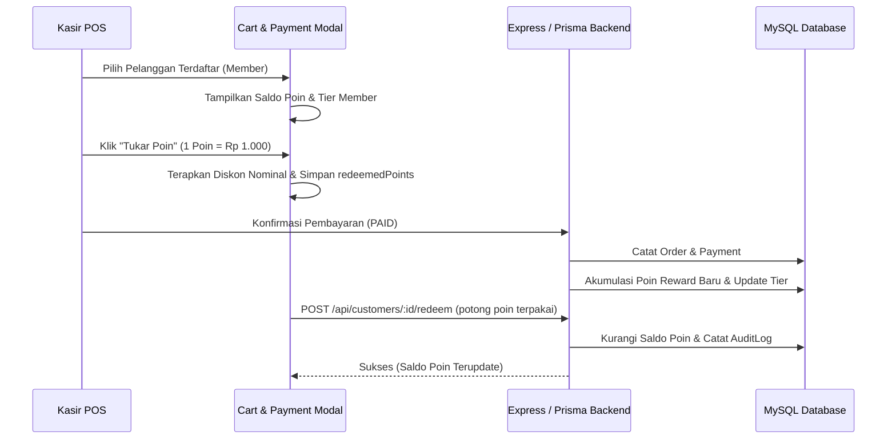

# Spesifikasi Teknis: Program Loyalitas & CRM Pelanggan

## 1. Arsitektur Komponen & Alur Data

## 2. Modifikasi File

### A. Backend
1. **`backend/src/controllers/orderController.js`**:
   - Di fungsi `createOrder` (jika langsung `isPaid`) dan `payOrder`:
     - Menghitung `pointsEarned = Math.floor(finalSpent / 10000)`.
     - Melakukan increment pada `points`, `totalSpent`, dan `visitCount`.
     - Mengkalkulasi tier member secara otomatis (`SILVER`, `GOLD` ≥ 200, `PLATINUM` ≥ 500).
2. **`backend/src/controllers/customerController.js`**:
   - Endpoint `POST /api/customers/:id/redeem` memvalidasi saldo poin yang cukup, mengurangi saldo di database, dan mencatat entri audit log ke `AuditLog`.

### B. Frontend
1. **`frontend/src/store/cartStore.js`**:
   - Menambahkan field state `redeemedPoints: 0`.
   - Menambahkan action `setRedeemedPoints(points)`.
   - Mereset `redeemedPoints` pada `clearCart` dan saat pergantian pelanggan.
2. **`frontend/src/components/pos/CartSidebar.jsx`**:
   - Menampilkan banner/tombol penukaran poin langsung di dalam popover diskon ketika pelanggan terpilih memiliki poin (`points > 0`).
   - Menyediakan fungsi `handleRedeemLoyaltyPoints(pointsToUse)` yang otomatis menerapkan potongan diskon nominal dan mengunci jumlah poin yang ditukarkan.
   - Mereset `redeemedPoints` jika kasir mengetik diskon manual/promo umum.
3. **`frontend/src/components/pos/PaymentModal.jsx`**:
   - Saat pembayaran order diselesaikan, jika `redeemedPoints > 0`, memanggil `useCustomerStore.getState().redeemPoints()` secara asynchronous dengan referensi nomor invoice pesanan.
4. **`frontend/src/pages/CustomersPage.jsx`**:
   - Menambahkan tombol **"Ekspor Excel"** yang menggunakan pustaka `xlsx` via `exportToExcel`.
   - Mengekspor atribut lengkap pelanggan: No, Nama Member, Nomor WhatsApp, Email, Tier Member, Saldo Poin, Total Belanja, Kunjungan, Catatan, dan Tanggal Bergabung.

## 3. Rencana Pengujian
1. **Build Verifikasi**: Jalankan `npm run build` pada folder frontend (Vite) untuk memastikan tidak ada chunking error.
2. **Syntax Verifikasi**: Jalankan `node -c` pada seluruh backend controllers.
3. **Integrasi POS**:
   - Pilih member dengan 50 poin.
   - Masukkan order senilai Rp 100.000.
   - Klik "Tukar Poin" -> Tagihan berkurang Rp 50.000.
   - Selesaikan transaksi -> Poin berkurang 50 dan bertambah sesuai pembelanjaan baru.
